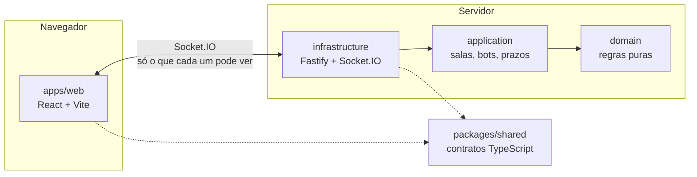

<div align="center">


# Fodinha

**O clássico jogo de cartas de palpite, agora online: chame os amigos, complete a mesa com bots e jogue direto no navegador.**

[](https://game.yagoriccomi.com.br)

[](https://github.com/yagoriccomi/jogo-de-cartas/actions/workflows/ci.yml)


[](LICENSE)

Sem cadastro · até 10 na mesa · celular e computador · servidor que não deixa ninguém espiar

</div>

---

## Índice

- [Por que jogar](#por-que-jogar)
- [Como se joga](#como-se-joga)
- [Regras completas](#regras-completas)
- [Recursos](#recursos)
- [Arquitetura](#arquitetura)
- [Rodando localmente](#rodando-localmente)
- [Testes e qualidade](#testes-e-qualidade)
- [Variáveis de ambiente](#variáveis-de-ambiente)
- [Deploy](#deploy)
- [Roadmap](#roadmap)

## Por que jogar

|                             |                                                                                                    |
| --------------------------- | -------------------------------------------------------------------------------------------------- |
| 🃏 **Mesa em segundos**     | Crie uma sala, mande o link no WhatsApp e pronto. Sem conta, sem download: só um apelido.          |
| 🤖 **Nunca falta gente**    | Até 6 bots completam a mesa, cada um com seu estilo: do cauteloso ao caótico, todos jogam bem.     |
| 🔒 **Jogo limpo**           | O servidor é a única autoridade: cada jogador recebe só o que pode ver. Não há como espiar cartas. |
| 🌆 **Visual Vice City**     | Feltro com neon rosa e ciano, cartas em pixel art e manilhas com brilho holográfico.               |
| 😂 **Mesa animada**         | Oito reações com animação e som próprios. E, de vez em quando, um trevo 🍀 dourado.                |
| 📱 **Feito para o celular** | Instalável na tela inicial, em tela cheia, com a partida inteira sem rolar a página.               |

## Como se joga

1. **Palpite.** Olhe sua mão e a vira e diga quantas vazas vai ganhar na rodada.
2. **Jogue.** Cada um joga uma carta por vaza; a mais forte leva. Cartas iguais se anulam.
3. **Conte.** Errou o palpite? Perde 1 vida por vaza de diferença, para mais ou para menos.
4. **Sobreviva.** As rodadas vão de 1 carta até o máximo e voltam a 1. O último com vida vence.

> 💡 Nunca jogou? O **tutorial interativo** da tela inicial ensina tudo numa partida roteirada contra 2 bots, e funciona mesmo sem o servidor do jogo.

## Regras completas

<details>
<summary><strong>Cartas, rodadas e palpites</strong></summary>

- **Baralhos e vidas:** de 1 a 4 baralhos misturados; cada jogador começa com 5 a 10 vidas. Dá para jogar com ou sem as cartas 8, 9 e 10.
- **Rodadas:** começam com 1 carta por jogador, sobem até o máximo que o baralho permite e voltam a 1, repetindo o ciclo.
- **Vira e manilhas:** uma carta é virada a cada rodada; a partir dela definem-se as manilhas, as cartas mais fortes.
- **Palpite:** antes de jogar, cada um diz quantas vazas (mãos) vai ganhar. O último a palpitar (o "pé") não pode dizer um número que feche a soma exatamente igual ao total de vazas da rodada, para que alguém sempre erre.
- **Vazas:** vence a carta mais forte. Cartas iguais se anulam: vale a próxima maior; se todas se anularem, ninguém leva a vaza.
- **Rodada cega:** na rodada de 1 carta, você não vê a sua, mas vê a dos outros jogadores (na testa). Assim que todos palpitam, as cartas vão sozinhas para a mesa, o resultado sai e o jogo segue.
- **Vidas:** ao fim da rodada, cada jogador perde 1 vida por vaza de diferença entre o palpite e o que ganhou. Quem zera vidas é eliminado; vence o último de pé.
- **Lugares e ordem:** a cada partida (e a cada reinício) os lugares na mesa são sorteados, assim como o primeiro pé; a mão é sempre quem vem depois dele.

</details>

<details>
<summary><strong>Sala, tempo e conexão</strong></summary>

- **Mesa:** até 10 participantes, com até 6 bots.
- **Tempo da vez:** o dono escolhe no lobby quanto tempo cada um tem para palpitar ou jogar: 15, 30, 45, 60 ou 90 segundos (padrão 30 s), ou sem limite. Estourado o prazo, o servidor joga pelo jogador e todos os bots da mesa reagem com um emoji sorteado.
- **Queda de conexão:** se alguém fica mais de 10 segundos desconectado, a partida pausa e os jogadores votam "Deseja esperar o retorno de [apelido]?". Basta um SIM para continuar esperando; se todos votarem NÃO, um bot termina a rodada dele e ele é eliminado. Quem cai e volta (até recarregando a página) retorna ao mesmo lugar.
- **Entrar no meio:** dá para entrar com a partida em andamento. Quem chega assiste até a próxima rodada e senta com a mesma quantidade de vidas do jogador vivo com mais vidas.
- **Resumo das regras:** no começo de cada partida aparece um resumo curto das regras, até o jogador marcar "Não perguntar novamente neste computador". Enquanto ele lê, a mesa inteira pausa e os outros veem "Jogador noob lendo as regras!" com o tempo restante: no máximo 60 segundos, uma vez por jogador por partida.
- **Dono da sala:** quem criou a sala pode pausar e retomar a partida quando quiser, reiniciá-la (volta à rodada 1 com vidas cheias para todos) e expulsar pessoas. Quem é expulso não consegue voltar àquela sala pelo mesmo navegador. Se o dono sair, o posto passa para quem está há mais tempo na sala, e volta para o criador se ele retornar.
- **Eliminados veem as cartas (opcional):** o dono decide, no lobby ou no menu lateral (inclusive no meio da partida), se quem já foi eliminado pode ver a mão de quem ainda joga, tocando na placa do jogador. Vem desligada. Quem ainda está vivo nunca recebe as cartas dos outros.
- **Saída no meio da rodada:** quem sai (ou é expulso) tem a rodada terminada por um bot e só então deixa a mesa.

</details>

<details>
<summary><strong>A mesa na tela</strong></summary>

- **Gesto único:** cartas, palpite e reações seguem o mesmo padrão: 1 toque seleciona e 2 toques rápidos confirmam. O palpite mantém o botão Confirmar; no teclado, Enter ou Espaço confirmam direto. Na primeira vez que alguém usa cada um deles naquele aparelho, a dica do gesto fica em destaque e depois volta ao normal.
- **Mão organizada:** suas cartas aparecem sempre da mais forte (à esquerda) para a mais fraca (à direita), considerando a manilha da rodada.
- **Cartas na mesa:** a carta que está ganhando fica sozinha à esquerda, com o nome de quem a jogou em cima; as demais que valem formam uma pilha ao lado, da mais forte para a mais fraca. Passe o mouse ou toque numa carta para ver quem a jogou. As que empataram e se anularam ficam na linha de baixo.
- **Montinhos:** cada vaza ganha vira um montinho na frente de quem ganhou; as vazas todas empatadas vão para um monte abaixo da manilha (no celular, só o contador). Acima da vira, um contador mostra a vaza da rodada (ex.: 2/5).
- **Ritmo:** a última vaza de cada rodada fica 3 segundos na mesa antes de ir para o montinho, e o resultado da rodada fica uns 6 segundos na tela (uns 4 a mais nas rodadas cegas, que se resolvem sozinhas). Quando a partida acaba, uma tela celebra o vencedor.
- **Sua vez:** a faixa "Sua vez!" cruza a mesa, suas cartas pulsam em rosa, toca uma campainha própria, o título da aba muda e as placas de cima rolam acompanhando quem está jogando. O seu tempo aparece uma vez só, na pílula "Sua vez": pulsa nos últimos 10 segundos e faz tic-tac nos últimos 5.
- **Placas:** seguem a ordem de jogo, com a mão à esquerda e o pé à direita. No primeiro palpite da partida elas dizem "MÃO" e "PÉ" por extenso; depois fica só o ícone (a mão e a pegada).
- **Durante os palpites:** o centro da mesa mostra quem está palpitando, quanto a mesa já pediu e quantos já palpitaram.
- **Painel de palpite:** pergunta "Vai fazer quantas?" e mostra o saldo em palavras ("Pediram 3 de 5 · sobram 2", ou "passou 1"). O botão diz "Toque num número" até haver escolha e depois "Confirmar N"; quem é o pé vê o aviso de que não pode fechar a soma, com o número proibido riscado. "Mostrar mais" abre quem já palpitou, em ordem, e quantos ainda palpitam depois de você.

</details>

## Recursos

**🎮 Jogo**

- Salas por código, sem cadastro: só o apelido, "Criar sala" ou "Entrar com código".
- Convite por link com mensagem pronta: compartilhamento nativo do aparelho, botão direto do WhatsApp ou cópia do link; o link já preenche o código da sala.
- A sala nasce com a configuração padrão e o anfitrião ajusta no lobby (baralhos, vidas, 8-9-10, tempo da vez), adiciona bots e inicia; o botão diz o que falta ("Adicione 1 jogador para iniciar").
- Bots que jogam como um bom jogador, sem trapacear (veem só o que um humano veria):
  - **Palpite:** pela força da mão, descontando o que a mesa já pediu; na rodada cega, pelas cartas na testa dos outros e pelo que os palpites deles revelam sobre a carta do bot. Sendo o pé, vão para o lado mais provável do número proibido.
  - **Para fugir da vaza** (palpite cumprido ou estourado), seguem uma escada: igualar uma carta já anulada, anular a que está ganhando, jogar a maior carta que não tem como ganhar, e só então arriscar.
  - **Para ganhar**, preferem uma carta difícil de superar quando ainda falta gente jogar, e esperam quem joga logo depois fazer a vaza dele para fechar a seguinte.
  - **Lembram** só da última vaza e das manilhas que ficaram à vista, e **atrapalham** os outros quando isso não lhes custa vida, mirando em quem tem mais vidas.
  - Não jogam sempre igual: de vez em quando uma decisão vai para a segunda melhor (no palpite, só quando as duas opções estão quase empatadas).
  - **Seis estilos em três grupos**, sorteados no começo de cada partida: cautelosos (Cauteloso, Estrategista), equilibrados (Equilibrado, Sabotador) e agressivos (Ousado, Caótico). Até 2 bots, qualquer estilo; com 3, um de cada grupo (às vezes o grupo do primeiro se repete); com 4 a 6, um de cada grupo e os demais sorteados, nunca mais de 3 do mesmo grupo. O Ousado pede mais e gasta as fortes cedo, o Cauteloso pede menos e só arrisca com carta segura, o Sabotador atrapalha até correndo risco, o Estrategista quase não erra e o Caótico erra bastante.
  - Quem estoura o tempo da vez tem a jogada feita pelo estilo Equilibrado.
- Placar a qualquer momento (vidas, palpite e vazas feitas de todos) e guia de regras ilustrado, passo a passo.
- Tutorial interativo com versão rápida, que pula os passos só explicativos.

**😂 Reações**

- O botão 😀 abre 8 emojis. 1 toque mostra a prévia (o emoji fica rosa, anima e toca o som); 2 toques rápidos enviam.
- Cada emoji tem animação e som próprios e aparece por uns 2,5 segundos sobre a placa de quem reagiu (no máximo uma reação a cada 1,5 segundo por jogador).
- 1 em cada 5 trevos 🍀 sai dourado, e todos na mesa veem o mesmo trevo.
- Quem reagiu fora da parte visível da faixa de placas aparece num aviso na borda daquele lado, com o emoji e o nome; tocar nele leva até a placa.
- Os bots também reagem: 10% de chance a cada carta que jogam, e todos de uma vez quando alguém estoura o tempo.

**🎨 Som e visual**

- Visual "Vice City": mesa de feltro com neon e cartas em pixel art; manilhas com brilho holográfico.
- Sons de fliperama sintetizados na hora (sem arquivos de áudio) e vibração na sua vez e ao perder vida.
- Música de fundo no clima cassino anos 80: city pop com pé na bossa (piano elétrico, baixo sincopado, aro de caixa, chocalho e sinos com eco), gerada pelo navegador com Web Audio, sem arquivo de música nem licença de terceiros. Começa depois do primeiro toque na tela e pausa quando a aba fica oculta.
- Menu lateral com o mudo geral (som, música e vibração) e volumes separados de música, efeitos e reações (todos começam em 50%, para não incomodar), salvos no aparelho.

**📱 Celular**

- Site responsivo e instalável (abre em tela cheia, com ícone na tela inicial). No Android aparece o botão "Instalar na tela inicial"; no iPhone, onde o Safari não permite esse botão, a tela inicial ensina o caminho: Compartilhar → Adicionar à Tela de Início.
- A partida nunca rola a tela e não deixa arrastar além dela; no celular o topo fica recolhido (toque na alça ou deslize para baixo a partir do topo para abrir) e o palpite aparece dentro da mesa, sem cobrir a mão nem as suas vidas.

## Arquitetura



- **Monorepo** com npm workspaces: `packages/shared`, `apps/server`, `apps/web` e `apps/e2e`.
- **Servidor autoritativo** em Clean Architecture: o domínio (baralho, força, vaza, rodadas, partida, estratégia de bot) não conhece rede, relógio nem aleatoriedade, o que deixa as regras testáveis de forma determinística.
- **Contrato único:** todo evento e estado vem de `@fodinha/shared`, reaproveitável pelo futuro app Android.
- **Salas em memória**, atrás de uma interface de repositório pronta para trocar por Redis.
- **Histórico das partidas** (opcional) no Turso, um SQLite na nuvem: cada rodada vira uma linha com as mãos, os palpites, as cartas na ordem e, em cada decisão, o que o jogador via e quem decidiu (pessoa, bot ou jogada automática). Jogadores só por id; o apelido não é gravado.

| Camada    | Tecnologias                                               |
| --------- | --------------------------------------------------------- |
| Web       | React, Vite, TypeScript, Web Audio, PWA                   |
| Servidor  | Node 24, Fastify, Socket.IO, TypeScript, tsup             |
| Banco     | Turso / libSQL (opcional, só o histórico das partidas)    |
| Qualidade | ESLint, Prettier, Vitest, Playwright, GitHub Actions      |
| Infra     | Docker e Docker Compose (dev), Vercel (web), Render (API) |

## Rodando localmente

**Pré-requisitos:** Docker Desktop (ou Docker Engine) com Compose v2.24+ **ou** Node.js 24 e npm.

### Opção 1: Docker (recomendada, um comando)

```bash
git clone https://github.com/yagoriccomi/jogo-de-cartas.git
cd jogo-de-cartas
./scripts/dev.sh start      # Windows: scripts\dev.bat start
```

Abra **http://localhost:5173** (saúde do servidor em http://localhost:3001/health). Outros comandos do mesmo script: `stop`, `restart`, `status` e `logs`.

Se o `.env` não existir, ele é criado a partir do `.env.example`. Na primeira execução, as dependências são instaladas dentro do container, o que leva alguns minutos.

<details>
<summary>Detalhes do ambiente Docker</summary>

- Sobem os serviços `server` e `web` com recarga automática ao salvar arquivos. O serviço `deps` roda uma vez para instalar as dependências e termina.
- O `node_modules` fica em volumes do Docker (não na sua pasta), porque binários instalados no Windows não funcionam dentro do container Linux. Para forçar uma reinstalação completa: `docker compose down -v`.
- Não há serviço de banco, cache nem fila no Compose: as salas ficam na memória do servidor. O histórico das partidas, se ligado, usa um arquivo local (veja abaixo).
- Porta já em uso (erro `port is already allocated`)? Troque `PORT` no `.env` e ajuste `VITE_SERVER_URL` para a mesma porta (ex.: `PORT=3011` e `VITE_SERVER_URL=http://localhost:3011`). Depois rode `restart`.
- O `package-lock.json` precisa conter os binários de todas as plataformas (Windows e Linux). Se for regenerá-lo, apague antes o `node_modules` e rode `npm install` do zero; caso contrário, o container pode falhar com erro de binário nativo (ex.: `rolldown`).

</details>

### Opção 2: Nativo (sem Docker)

```bash
npm install
cp .env.example .env        # PowerShell: Copy-Item .env.example .env
npm run dev                 # sobe servidor e web juntos
```

Ou separadamente: `npm run dev:server` e `npm run dev:web`. O servidor lê o `.env` da raiz (porta em `PORT`); o web aponta para `VITE_SERVER_URL`. Se os dois não baterem, a tela de conexão avisa que o servidor local não respondeu.

### Testar com 10 jogadores

Com o servidor de desenvolvimento (`CENARIOS_DE_TESTE=true`, já ligado no Docker de dev; no modo nativo, defina a variável) abra **http://localhost:5173/?cenario=10x13**: você entra sozinho numa partida com 10 jogadores (você + 9 bots), 4 baralhos sem 8, 9 e 10, e 13 cartas na primeira rodada.

- O formato é `?cenario=JOGADORESxCARTAS`; só `?cenario` equivale a `10x13`. Com 10 jogadores o máximo é 15 cartas.
- Se o servidor reiniciar, o cliente recria o cenário sozinho; se só o web recarregar, você volta à mesma partida.
- O parâmetro é ignorado no build de produção.

### Histórico das partidas (opcional)

Sem `TURSO_DATABASE_URL`, nada é gravado e o jogo funciona igual. Para gravar localmente, sem conta em lugar nenhum, use um arquivo libSQL no `.env`:

```bash
TURSO_DATABASE_URL=file:./dados/fodinha.db
```

O arquivo fica em `apps/server/dados/fodinha.db` (a pasta `dados/` está no `.gitignore`). As migrations de `apps/server/migrations/` são aplicadas sozinhas na subida do servidor. Tutorial e cenários de teste (`?cenario=`) não são gravados.

Para exportar as decisões gravadas como dados de treino (um JSON por linha, sem apelido):

```bash
npm run exportar-treino -w apps/server -- --url file:./dados/fodinha.db --saida treino.jsonl
```

Sem `--url`, o comando usa `TURSO_DATABASE_URL` (e `TURSO_AUTH_TOKEN`); sem `--saida`, escreve na tela. Cada linha traz a visão do jogador no momento da decisão, a decisão (palpite ou carta), quem decidiu e como a rodada terminou para ele.

## Testes e qualidade

```bash
npm test            # testes de unidade (Vitest): regras do servidor e cálculos puros do web
npm run typecheck   # checagem de tipos
npm run lint        # ESLint
npm run build       # build de todos os pacotes
npm run format      # formata com Prettier
npm run test:e2e    # testes de tela (Playwright)
npm run simular -w apps/server -- --pares 2000 --mesas 3,10   # simulação acelerada dos bots, em paralelo
```

Os **testes de tela** abrem o jogo de verdade num Chromium em 5 tamanhos (de 360×640 a 1920×1080) e conferem o que já quebrou antes: a mesa cheia (10 jogadores, 13 cartas) sem rolar a página, o palpite cabendo no feltro, o resumo das regras e a dica das reações, as cartas dentro da mesa, placar e regras, e o tutorial inteiro, com todo balão apontando para algo visível. Eles sobem sozinhos um servidor e um web de teste nas portas 3101 e 5199, então funcionam com o Docker de desenvolvimento ligado. Na primeira vez, instale o navegador: `npx playwright install chromium` (dentro de `apps/e2e`).

A cada push e pull request, o GitHub Actions executa lint, typecheck, testes, build e os testes de tela.

## Variáveis de ambiente

Copie o `.env.example` para `.env`. Só o `TURSO_AUTH_TOKEN` é segredo, e ele é opcional: sem banco configurado, nada é gravado.

| Variável             | Onde     | Para que serve                                                                                                                           |
| -------------------- | -------- | ---------------------------------------------------------------------------------------------------------------------------------------- |
| `PORT`               | servidor | Porta HTTP/WebSocket do servidor de jogo (padrão `3001`).                                                                                |
| `CORS_ORIGINS`       | servidor | Origens autorizadas a conectar, separadas por vírgula (padrão `http://localhost:5173`).                                                  |
| `LOG_LEVEL`          | servidor | Nível de log: `debug`, `info`, `warn` ou `error`.                                                                                        |
| `BOT_DELAY_MS`       | servidor | Milissegundos que o bot espera antes de jogar (padrão `2000`). Os testes de tela usam um valor baixo.                                    |
| `CENARIOS_DE_TESTE`  | servidor | Só desenvolvimento (padrão `false`; o Docker de dev liga). Libera a criação de salas de teste com bots. Nunca habilite em produção.      |
| `TURSO_DATABASE_URL` | servidor | Opcional. Banco do histórico das partidas: `libsql://...` (Turso) ou `file:./dados/fodinha.db` (arquivo local). Sem ela, nada é gravado. |
| `TURSO_AUTH_TOKEN`   | servidor | Opcional. Token do Turso (segredo; nunca no Git). O arquivo local não precisa.                                                           |
| `VITE_SERVER_URL`    | web      | URL pública do servidor de jogo. Fica exposta no navegador: nunca coloque nada sensível.                                                 |
| `WEB_PORT`           | Docker   | Opcional. Porta do frontend no host (padrão `5173`). Se mudar, inclua a nova origem em `CORS_ORIGINS`.                                   |

## Deploy

O frontend vai para a **Vercel** e o servidor de jogo para a **Render**.

### Backend na Render

1. No painel da Render, crie um **Blueprint** apontando para este repositório; o `render.yaml` na raiz descreve o serviço (web service Node, plano grátis, verificação de saúde em `/health`).
2. Defina `CORS_ORIGINS` com a URL do frontend (por exemplo `https://game.yagoriccomi.com.br`). Várias origens são separadas por vírgula.
3. `LOG_LEVEL` já tem valor padrão no Blueprint.
4. Opcional, para gravar o histórico: crie um banco no Turso e defina `TURSO_DATABASE_URL` e `TURSO_AUTH_TOKEN` no painel. Sem elas o servidor roda igual, sem gravar; se o banco não responder na subida, o jogo sobe mesmo assim e o erro aparece no log.

Também há um `Dockerfile` de produção em `apps/server/Dockerfile` (build multi-stage, usuário não-root). Para gerar a imagem, a partir da raiz: `docker build -f apps/server/Dockerfile -t fodinha-server .`

> [!WARNING]
> **Plano grátis da Render:** o serviço hiberna depois de alguns minutos sem tráfego e reinicia ao receber a próxima requisição. Como as salas ficam na memória do servidor, **toda partida em andamento é perdida** quando isso acontece, e a primeira conexão após a hibernação demora. Para jogar com amigos sem surpresas, use um plano pago ou, na fase 2, a persistência em Redis.

### Frontend na Vercel

1. Importe o repositório na Vercel e defina o **Root Directory** como `apps/web`.
2. Configure `VITE_SERVER_URL` com a URL pública do serviço na Render.
3. Faça o deploy. Depois, volte à Render e confirme que `CORS_ORIGINS` contém a URL final do frontend.

## Roadmap

- [ ] Publicar na Play Store empacotando o site instalável (TWA/Capacitor), sem reescrever o jogo
- [ ] Login e contas de jogador
- [ ] Banimento à prova de aba anônima (depende de login)
- [ ] Tela de histórico e replay das partidas (a gravação por rodada já existe)
- [ ] Ranking
- [ ] Redis para o estado das salas e escala horizontal (o repositório de salas já fica atrás de uma interface para essa troca)
- [ ] Chat na mesa

## Licença

Distribuído sob a [licença MIT](LICENSE).

<div align="center">

Feito com 🃏 e neon por [@yagoriccomi](https://github.com/yagoriccomi)

</div>
